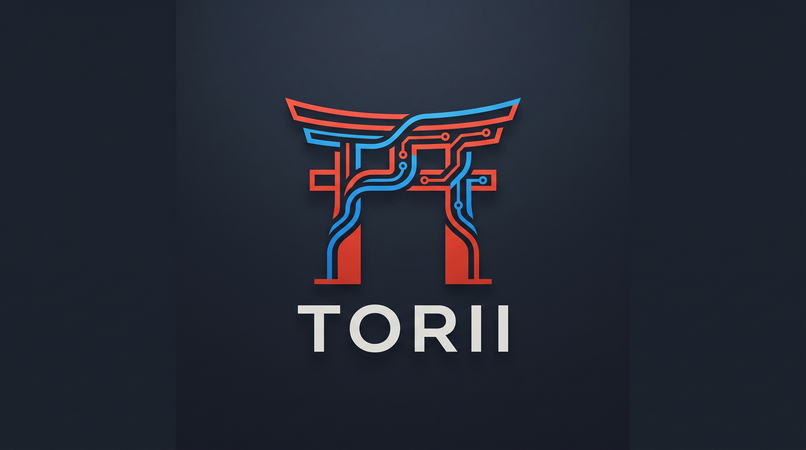

# Torii



Torii łączy **dane, transformacje, modele, eksperymenty i analizy** w jednym
interfejsie. Obiekt, jego niezmienna wersja oraz konkretne wykonanie są
rozdzielone, aby można było prześledzić pochodzenie wyniku.

Dziś można uruchomić lokalny demonstrator z rzeczywistym treningiem i MLflow.
Docelowa wieloużytkownikowa platforma korporacyjna jest nadal w budowie —
demo nie oznacza gotowości enterprise ani zgodności z całym Databricks.

## Uruchom działające demo

Wymagane na Windows: **Python 3.12**, **uv**, **Node.js ≥24.15.0 i <25**
oraz **npm 11** dostępne w terminalu. Docker nie jest potrzebny.
Pierwszy start wymaga pobrania zależności.

Z katalogu tego repozytorium, w PowerShell:

```powershell
.\scripts\demo.ps1
```

Otwórz [Torii — lokalne demo](http://127.0.0.1:18440).
Skrypt przygotowuje osobne środowisko Python, buduje interfejs i uruchamia
własny proces w tle. Status i zatrzymanie:

```powershell
.\scripts\demo.ps1 -Action Status
.\scripts\demo.ps1 -Action Stop
```

**Tylko lokalnie, jeden operator, bez SSO. Nie używaj danych firmowych i nie
udostępniaj serwera przez LAN ani Internet.** Stop zachowuje dane; podczas
aktywnego treningu należy zaczekać na wynik.

Na początek utwórz projekt, dodaj dane przykładowe, zapisz i wykonaj
transformację, a następnie porównaj Ridge z baseline średniej.
Zobaczysz rzeczywiste metryki, wersje danych, pochodzenie wyniku i ID MLflow.

- [Instrukcja demo i scenariusz 5–10 minut](apps/demo/README.md)
- [Uruchamianie, dane lokalne i rozwiązywanie problemów](docs/demo-operations.md)
- [Architektura demonstratora](docs/demo-architecture.md)
- [Prezentacja HTML konceptu](docs/presentation/torii.html) — otwórz lokalny plik w przeglądarce; nie zastępuje aplikacji.

## Trzy odrębne części repozytorium

| Obszar | Co zawiera | Stan i granica |
|---|---|---|
| **Demo** — `apps/demo`, `apps/web/demo.html` | FastAPI, React, SQLite, CSV/synthetic, transformacje, Ridge/baseline, lokalny MLflow i wyniki | Działająca demonstracja jednoosobowa. Nie zapewnia SSO, współdzielenia ani wdrożeń produkcyjnych. |
| **Fundament enterprise** — `apps/api`, `apps/web/index.html`, `deploy/platform` | Domeny i transakcje projektów, komponenty tożsamości/OIDC, kontrakty, UI i odizolowana infrastruktura | Integracja pełnego logowania oraz API z interfejsem pozostaje nieukończona. Nie jest gotowym produktem. |
| **Legacy** — `docker`, główne pliki Compose, `scaffold` | Obrazy Python, Jupyter/code-server, warsztaty AutoML oraz starszy stos MLflow/MinIO/DataHub | Zachowane środowisko i historia danych. Osobne instrukcje; nie uruchamia nowego GUI. |

Demo przechowuje dane i artefakty w ignorowanym `apps/demo/.local/data`.
Nie korzysta z głównego `.env` ani starszych wolumenów Docker.
Eksport projektu zawiera definicje, hashe, metryki i środowisko, ale **nie**
wiersze danych, predykcje ani model. Nie jest pełnym pakietem odtworzeniowym.

SQL/Parquet, Jupyter w nowym GUI, dowolne modele nie-ML, pełne XAI,
współdzielenie i produkcyjne wydania pozostają poza zakresem obecnego demo.

## Rozwój platformy — specyfikacja przed kodem

[Plan platformy](docs/platform/README.md), [plan sprintów](docs/platform/sprint-plan.md)
i [dziennik realizacji](docs/platform/delivery-progress.md) rozróżniają cel
produktu, wdrożone komponenty i brakujące kryteria odbioru.
Zmiany powstają zgodnie z [Spec Driven Development](docs/platform/spec-driven-development.md)
oraz [zasadami repozytorium](AGENTS.md).

Dokumentacja techniczna: [backend enterprise](apps/api/README.md),
[frontend i oba punkty wejścia](apps/web/README.md),
[infrastruktura enterprise](deploy/platform/README.md),
[SPEC-0018 demo](specs/0018-concept-demo/README.md)
oraz [logo i jego pochodzenie](docs/brand/README.md).

## Korzystasz ze starszego AutoML / Dockera?

Przejdź do [zachowanych instrukcji legacy](docs/legacy-workspaces.md).
Przed poleceniami Compose przeczytaj [instrukcję migracji Torii](docs/torii-migration.md)
i [ustawienia lokalnej instalacji](docs/local-installation.md).
Jawne `-f` może zastąpić wybór plików z `.env` i uruchomić stos z innymi
wolumenami. Nie usuwaj starych danych ani nie uruchamiaj dwóch stosów na tych
samych wolumenach.

Repozytorium: [satanisz/torii](https://github.com/satanisz/torii).
