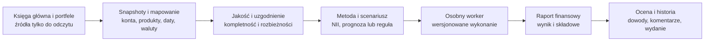

# Torii jako warsztat finansów banku

Data przeglądu źródeł: 2026-10-09. Status: rekomendacja architektury i zakresu;
wdrożony zakres oraz dowody opisuje SPEC-0019, nie tabela produktów poniżej.

Aktualizacja 2026-10-10: użytkownik potrzebuje przede wszystkim katalogu
wersjonowanych obiektów i grafu zależności. [Architektura obiektów](enterprise-object-platform.md)
i [plan sprintów 0.2](sprint-plan.md) określają teraz kolejność realizacji.
Finanse poniżej są zastosowaniem wspólnej platformy; laboratorium NII
nie zastępuje jej fundamentu enterprise.

**Rekomenduję budowę Torii wokół księgi głównej, portfeli i wersjonowanych
analiz finansowych. Pierwszym procesem będzie uzgodnienie danych oraz analiza
NII w scenariuszach stóp.** ML jest jednym z narzędzi tej platformy, obok
kalkulacji finansowych, reguł jakości i prognoz statystycznych.

Użytkownik wskazał finanse: bazy z księgami głównymi i portfelami,
prognozowanie zysków, anomalie oraz obliczanie NII. To zastępuje wcześniejsze
przykłady opóźnień dostaw, fraud i planowania gotówki jako pierwszy temat.
Dobór techniczny prowadzi asystent; użytkownik określa cel i ocenia użyteczność.
Nie trzeba wybierać frameworków, aby rozpocząć pracę nad takim produktem.

## Dwie rodziny gotowych rozwiązań

Platforma analityczna porządkuje dane, kod, wykonania i wdrożenia. System ALM
(zarządzania aktywami i pasywami) dostarcza dodatkowo metodykę instrumentów,
przepływów i ryzyk bilansu. Nasze potrzeby leżą na styku tych rodzin.

| Rozwiązanie | Zakres potwierdzony przez dostawcę | Co przejmujemy jako wzorzec |
|---|---|---|
| [Dataiku](https://doc.dataiku.com/dss/latest/flow/index.html) | Projekty i Flow danych; [bundle](https://doc.dataiku.com/dss/latest/deployment/creating-bundles.html) do przenoszenia projektu; osobne wykonanie batch i API | Jedna ścieżka analityka od źródła przez transformację do wyniku, wersjonowanie pakietu analizy |
| [Databricks](https://docs.databricks.com/aws/en/machine-learning/mlops/mlops-workflow) | Zintegrowana praca na danych i ML; katalog, tracking, zadania i rozdzielenie cyklu kodu od modelu | Spójne metadane źródeł i wyników, kontrolowana praca SQL/Python; nie budujemy własnego Spark |
| [Oracle Financial Services ALM](https://www.oracle.com/industries/financial-services/analytics/asset-liability-management/) | Symulacja dochodu, analiza przeszacowania i płynności, scenariusze oraz analityka ALM | Portfel, data analizy, założenia i scenariusz są wejściami modelu; wynik musi dać się rozłożyć na składowe |
| [SAS ALM](https://www.sas.com/es_es/software/asset-liability-management/features-list.html) | Przepływy kontraktowe i behawioralne, analizy NII/EVE, statyczny i dynamiczny bilans, scenariusze rynkowe | Jawne założenia przepływów i zachowań klientów; agregacja i zejście do pozycji |
| [OneSumX Financial Risk Management](https://assets.contenthub.wolterskluwer.com/api/public/content/onesumx-for-financial-risk-management?v=0a3aab5b) | Kalkulacja i symulacja NII oraz metody wyceny instrumentów w szerszym zarządzaniu ryzykiem | Powiązanie wspólnych danych finansowych ze scenariuszami, metodami i raportami |
| [OpenShift AI](https://docs.redhat.com/en/documentation/red_hat_openshift_ai_self-managed/3.5) | Workbenches, pipeline’y i model serving na OpenShift | Rozdzielenie miejsca pracy analityka od zarządzanego środowiska wykonawczego |
| [SageMaker AI](https://docs.aws.amazon.com/sagemaker/latest/dg/model-registry-approve.html) | Usługi ML i rejestr ze statusami akceptacji wersji modelu | Gotowe usługi mogą realizować część platformy; proces banku pozostaje osobną odpowiedzialnością |

Dataiku Govern jest [dodatkowym licencjonowanym węzłem](https://doc.dataiku.com/dss/latest/governance/index.html).
Wymuszenie zgody zależy od [polityki wdrażania](https://doc.dataiku.com/dss/latest/governance/deployment-policies.html).
Databricks [deployment jobs](https://docs.databricks.com/aws/en/mlflow/deployment-job)
mają obecnie status Public Preview, a opisany mechanizm approval jest
eksperymentalny. Nie opieramy własnej bramki dopuszczenia wyłącznie na nazwie
produktu lub jego domyślnej konfiguracji.

Nie oceniano cen, ofert handlowych ani zgodności konkretnej instalacji banku.
Funkcje opisane przez dostawcę nie potwierdzają, że konfiguracja jest wdrożona
w Torii. Platformy analitycznej nie utożsamiamy z gotową metodyką NII;
systemu ALM nie redukujemy do modelu ML.

## Czego uczą rzeczywiste wdrożenia

[NatWest i AWS, 2022](https://aws.amazon.com/blogs/machine-learning/part-1-how-natwest-group-built-a-scalable-secure-and-sustainable-mlops-platform/)
opisują platformę opartą na usługach zarządzanych i wspólnych szablonach,
z zabezpieczonymi środowiskami oraz powtarzalnym procesem wdrażania.
[DenizBank i Red Hat, 2025](https://www.redhat.com/en/blog/denizbank-drives-ai-innovation-red-hat-openshift-ai)
pokazują wariant OpenShift we własnej infrastrukturze i dostarczanie przez GitOps.
To opisy historycznych wdrożeń, nie audyt ich stanu w 2026 roku.

Wniosek dla nas: wartością własnej platformy są wspólne kontrakty danych,
przebieg pracy, kontrola i wyjaśnienie wyniku. Miejsce obliczeń może być różne.
Nie wiemy, jakie produkty wykorzystuje klient ogłoszenia Billennium.

## Proponowany przepływ finansowy

Docelowo rozdzielamy datę stanu portfela, okres księgowy, datę udostępnienia
danych, scenariusz oraz horyzont projekcji. Korekta księgi tworzy nową wersję
snapshotu; nie zmienia raportu historycznego. Każdy wynik wskazuje metodę,
wersje danych i założeń oraz wykonanie, które go wytworzyło.

Uzgodnienie wymaga ustalenia wspólnego zakresu wartości: np. kapitał portfela
porównujemy z odpowiednimi kontami kapitałowymi. Odsetki naliczone, korekty,
odpisy i różnice wyceny mogą wymagać osobnych mostków uzgodnieniowych.
Nie zakładamy, że dowolne saldo GL powinno równać się sumie nominałów.

Analityk finansowy wybiera dane i scenariusz, sprawdza uzgodnienie i analizuje
wynik. Autor metody rozwija kalkulację. Walidator niezależnie ocenia metodę
i ograniczenia. Operator utrzymuje wykonania oraz dane. Docelowy backend
egzekwuje te uprawnienia; samo przełączanie roli na ekranie nie jest kontrolą.

## Konkretny wybór techniczny

| Obszar | Wybór dla Torii | Uzasadnienie i granica |
|---|---|---|
| Interfejs | Istniejący React/TypeScript | Ekrany danych, uzgodnienia, scenariuszy i raportów w jednym produkcie |
| Sterowanie | Istniejący FastAPI, modularny monolit | Projekty, wersje, metody, scenariusze i wykonania mają wspólne kontrakty |
| Metadane docelowe | PostgreSQL | Trwałe powiązania, transakcje, audyt; osobne role i bazy usług |
| Tożsamość docelowa | OIDC, Keycloak lokalnie | Integracja firmowego IdP przed pracą wieloużytkownikową; obecne demo nie ma SSO |
| Wejścia docelowe | Konektory read-only i wersjonowane snapshoty w storage S3-compatible | Wynik odtwarzamy z konkretnego wejścia, nie z aktualnego zapytania do zmiennej bazy |
| Kalkulacje finansowe | Python; Decimal dla kwot, jawny kontrakt konwencji odsetkowych | Ręcznie sprawdzalne fixtures; żadnego uczenia modelu do zastępowania prostej formuły |
| Eksperymenty ML | Istniejący adapter MLflow | Tracking prognoz/anomalii ML; projekcja NII może być modelem deterministycznym |
| Wykonanie | Osobne worker jobs; docelowo adapter firmowego schedulera/Kubernetes Jobs | API nie wykonuje kodu użytkownika; stan prób i publikacja wyników należą do Torii |
| Obserwowalność | Identyfikator wykonania, jakość danych, logi, metryki czasu i wyniku | Należy obserwować również nieuzgodnione wejścia i niepełny raport |

W lokalnym SPEC-0019 wykorzystujemy istniejący profil demo, osobny subprocess
i wydzielony magazyn SQLite. To środowisko sprawdzenia sposobu pracy i rachunku,
nie wdrożenie docelowego PostgreSQL/OIDC/S3. Nie kupujemy usług ani licencji.

MLflow OSS ma obecnie [workspaces i RBAC](https://mlflow.org/docs/latest/self-hosting/security/basic-http-auth/)
oraz możliwości [SSO](https://mlflow.org/docs/latest/self-hosting/security/sso/).
Ich istnienie nie dowodzi aktywacji w naszej instalacji. Nie traktujemy aliasu
modelu jako zatwierdzonego wydania całej analizy finansowej.

Kubeflow Pipelines rozważymy dopiero przy uzasadnionej potrzebie orkiestracji
wielu kroków na klastrze. KServe/online i agenci nie są pierwszym problemem
finansowego batcha. Nie budujemy własnego notebooka, hurtowni, Spark ani
pełnej alternatywy dla Oracle/SAS ALM.

## Pierwszy użyteczny przyrost

[SPEC-0019](../../specs/0019-bank-finance-lab/README.md) definiuje laboratorium:

1. Syntetyczny wycinek portfela aktywów i pasywów oraz odpowiadające salda GL.
2. Uzgodnienie sald z możliwością pokazania celowej rozbieżności.
3. Bazowy NII i scenariusz zmiany stóp, 12 miesięcy, PLN, rozbicie na pozycje.
4. Wrażliwość na termin przeszacowania i przyjętą reakcję oprocentowania depozytów.
5. Regułę sygnalizującą nietypową zmianę historycznego NII.
6. Historię wykonań i eksport wyniku wraz z wejściami i wersją metody.

NII obejmuje wynik odsetkowy. Prognoza zysku wymaga dodatkowo m.in. prowizji,
kosztów działania, odpisów i podatków, które będą odrębnymi blokami.
Ryzyko stopy procentowej i wpływ na dochody opisuje
[Basel Framework SRP98](https://www.bis.org/committees/bcbs/basel-framework/standard/srp/98/inforce/2026-01-01/published/2024-07-16).
Uproszczone scenariusze laboratorium nie są pomiarem regulacyjnym IRRBB.

## Kolejność rozwoju po laboratorium

| Przyrost | Konkretny rezultat | Warunek odbioru |
|---|---|---|
| B1 Dane finansowe | Jeden uzgodniony konektor read-only, słownik kont i produktów, daty oraz wersje snapshotów | Znany zakres księgowy uzgadnia się, korekta nie nadpisuje historii |
| B2 Kalkulacja i scenariusze | Harmonogramy kontraktowe, uzgodnione konwencje stóp, rozkład NII na portfele | Fixtures i wyniki referencyjne zaakceptowane przez znawcę metodyki |
| B3 Prognoza wyniku i anomalie | P&L z komponentami, baseline i modele statystyczne/ML | Backtest chronologiczny, porównanie z baseline, dane dostępne na datę prognozy |
| B4 Utrzymanie zespołowe | Pełne SSO, role, niezależna walidacja, harmonogramy, monitoring i odtworzenie | Rzeczywiste testy wielu ról i awarii na wybranej infrastrukturze |

B1–B4 to zakresy produktu, a nie automatycznie zatwierdzone sprinty. Kontrole
tożsamości, danych i wykonania istniejącej roadmapy muszą być domykane wraz
z zależnymi funkcjami, nie odkładane do końca. [ADR-0005](../../adr/0005-bank-finance-workbench.md)
opisuje granice pierwszego kroku.

Następnym wkładem użytkownika może być opis jednej istniejącej analizy:
co jest wejściem, jaki raport powstaje i jak sprawdza się jego poprawność.
Na jego podstawie przygotujemy następne kontrakty; wybór bibliotek pozostaje
zadaniem technicznym, a metodyka wymaga potwierdzenia przez jej właściciela.
