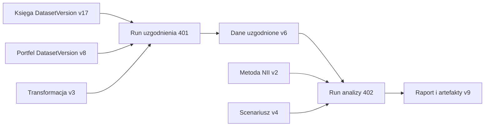
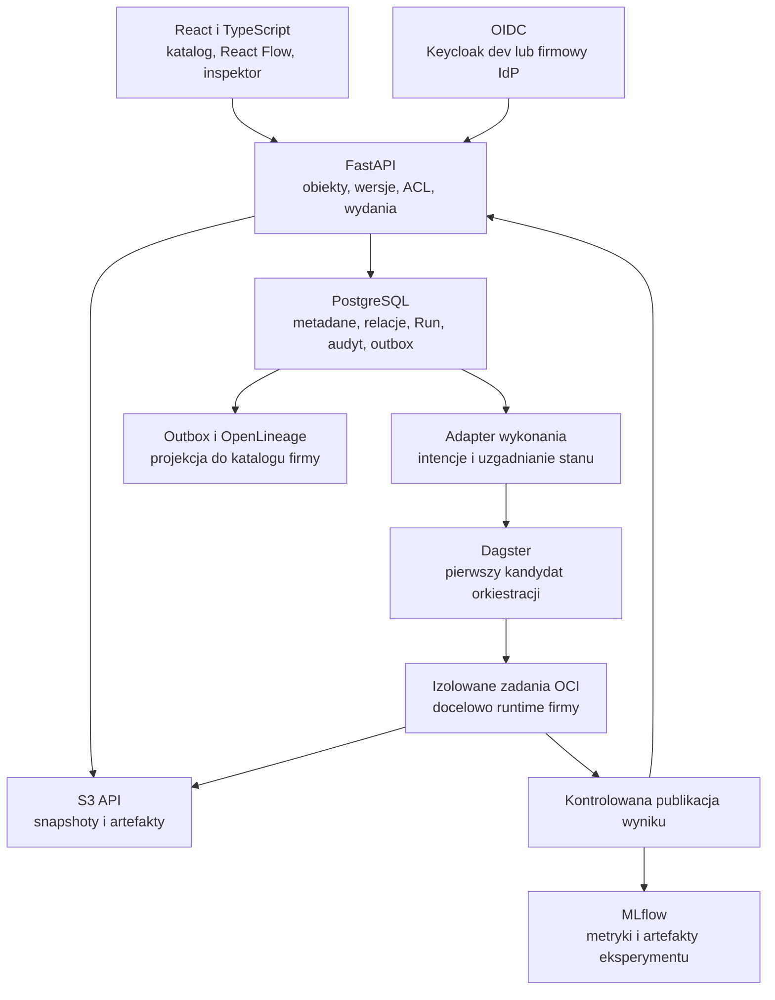

# Torii jako platforma obiektów i ich pochodzenia

2026-10-10. Status: propozycja architektury do realizacji przez osobne SPEC.
Użytkownik zlecił plan zmian w sprintach i potwierdził, że „edge technology”
oznacza nowoczesny stos oraz graf zależności. Plan nie uruchamia implementacji
ani automatyzacji. Kolejność prac ma jedno źródło: [plan sprintów](sprint-plan.md).

Centrum Torii stanowią dane, transformacje, eksperymenty i ich niezmienne
wersje. Analityk pracuje na katalogu, zależnościach, kodzie i wykonaniach.
Raport finansowy jest wynikiem takiego procesu. Finanse banku pozostają
pierwszym zastosowaniem wspólnej platformy, bez zaszywania NII w jej rdzeniu.

## Punkt startu

Przegląd kodu z 2026-10-10 potwierdził trzy różne poziomy gotowości:

| Obszar | Co istnieje | Co należy domknąć |
|---|---|---|
| Enterprise API | [Serwis projektów](../../apps/api/src/torii_api/application/projects.py), grants, audyt, transakcje, komponenty OIDC | [Aplikacja HTTP](../../apps/api/src/torii_api/app.py) wystawia tylko dwa health endpoints; potrzebne auth, session, projekty i E2E |
| Enterprise UI i baza | Klient HTTP, powłoka, projekty/dostęp/audyt; migracja tożsamości i projektów | Brak działającego katalogu obiektów, wersji, snapshotów, wykonań i lineage |
| Demo | Działające dane/transformacje/MLflow oraz osobne laboratorium NII | Referencja zachowań i rachunku; SQLite i brak SSO nie stają się fundamentem enterprise |

OpenAPI opisuje także przyszłe ścieżki obiektów i wersji. Kontrakt i testy
komponentów nie oznaczają, że te operacje są dostępne przez działające API.
Wykorzystujemy istniejący kod po weryfikacji, zaczynając od brakującego
transportu OIDC B2a4b, orchestration i integracji HTTP. Dowody historyczne
pozostają w [dzienniku](delivery-progress.md).

## Doświadczenie pracy

Domyślny ekran projektu to **katalog zasobów**, z przełączaniem tabela/graf,
wyszukiwaniem, filtrami typu/właściciela/stanu i wybraną wersją. Stała
nawigacja obejmuje Katalog, Flow, Wykonania, Eksperymenty, Modele, Wydania
i Administrację, w miarę dostarczania ich funkcji.

| Miejsce pracy | Co użytkownik rozstrzyga |
|---|---|
| Katalog | Jakie zasoby istnieją, do kogo należą, które wersje są dostępne? |
| Obiekt i inspektor | Definicja, schemat, wersje, diff, użycia, jakość, kod, artefakty i uprawnienia |
| Graf zależności | Skąd pochodzi wybrany wynik i jakie zasoby mogą odczuć zmianę? |
| Flow | Jak połączyć porty konkretnych operacji, zwalidować plan i go uruchomić? |
| Run | Jakie wersje wejść przekazano, jakie odczyty potwierdza instrumentacja, które próby wykonano i gdzie są wyniki? |
| Eksperyment | Które próby mają porównywalny protokół oceny i dlaczego wynik się zmienił? |
| Wydanie | Co dokładnie zatwierdzono i wdrożono do danego środowiska? |

Interfejs ma gęstość roboczą: czytelne tabele, panel szczegółów, precyzyjne
stany, deep links i filtrowanie. Wykresy służą analizie wybranego obiektu lub
eksperymentu. Każdy węzeł otwiera rzeczywisty zasób; przesunięcie go na planszy
nie zmienia danych. Tabela/lista zapewnia równoważną nawigację klawiaturą.
Obowiązuje [SPEC-0017](../../specs/0017-interface-foundation/README.md),
z nową rewizją kontraktu grafu przed jego implementacją.

## Model obiektów

| Pojęcie | Proponowany kontrakt |
|---|---|
| Object | Stałe ID, typ, projekt, nazwa, właściciel i polityka dostępu |
| Draft | Edytowalna definicja z rewizją/ETag; konflikt zachowuje pracę obu autorów |
| DefinitionVersion | Niezmienna definicja danych, transformacji, modelu, Flow lub analizy |
| DatasetVersion | Faktyczny snapshot: schema, manifest, digesty, lokalizacja i gwarancja retencji |
| ExperimentVersion | Nowe rozszerzenie do SPEC-0010: zamrożony protokół oceny, dane/split, metryki, konfiguracja i dozwolone warianty prób |
| Run / StepRun / Attempt | Konkretne wykonanie i jego próby, przypięte wejścia/kod/runtime, tożsamość, stan i wyjścia |
| Artifact | Bajty danych/modelu/raportu z digestem i kontrolowanym dostępem |
| Release / Deployment | Zamrożony pakiet dowodów i jego wdrożenie do środowiska |

ExperimentVersion jest propozycją rozszerzenia wcześniejszego
[modelu domenowego](domain-model.md), nie istniejącym API. Nowy protokół
lub nowy zbiór oceny tworzy nową wersję. Każdy Run przypina także konkretny
wariant parametrów i modelu. UI ostrzega lub rozdziela porównanie przy różnych
protokołach; nazwa metryki sama nie dowodzi porównywalności.

Parametry finansowe również mają wersję, np. jako typowany kontrakt wejściowy
AnalysisVersion; dokładny typ zamraża SPEC-0011. Zmieniony scenariusz lub korekta
księgi nie zmienia starego raportu. „Latest” może pomagać w przygotowaniu
planu, lecz przed wykonaniem zostaje rozwiązane do konkretnych wersji.

## Trzy rodzaje grafu

1. **Zależności deklarowane** wskazują referencje między definicjami i wersjami.
   Dostępne już w SP-02; brak wykonania jest jawny.
2. **Pochodzenie wykonania** wskazuje przypięte/przekazane DatasetVersion,
   wersje kodu oraz opublikowane artefakty Runu. Import dochodzi
   w SP-03, transformacje w SP-04, eksperymenty w SP-10A.
3. **Plan Flow** jest edytowalnym DAG operacji i portów. Waliduje się go
   przed wykonaniem w SP-06. Nie zastępuje historycznych zależności Runu.

Przykład docelowego pochodzenia raportu finansowego:

To model docelowy, nie opis dzisiejszego demo. Krawędzie mają typ, tożsamości
końców, porty i kontekst definicji lub Run/Attempt. Relacje historyczne powstają
z zatwierdzonych manifestów wykonania. Worker nie może dopisać cudzych wejść
ani zadeklarować gotowego wyniku bez finalizacji artefaktu.

Manifest dowodzi przypięcia i przekazania wejścia. Sam nie dowodzi, że dowolny
kod Python rzeczywiście odczytał wszystkie przekazane dane. Relacja rozróżnia
`provided input` i `observed read`; drugą wolno oznaczyć dopiero przy dowodzie
z instrumentowanego operatora/I/O. Zapisujemy źródło i zakres pokrycia dowodu.

Backend filtruje graf według praw do metadanych i artefaktów, ogranicza głębokość
oraz liczbę węzłów i stronicuje rozwijanie. Oznaczenie przycięcia wynika wyłącznie
z limitu dozwolonego zbioru, nie z wykrycia nieuprawnionych zależności. Analiza wpływu
rozróżnia konsumentów obecnej definicji od historycznych użyć wersji. Nie ujawnia
ukrytych nazw, identyfikatorów ani liczników zależności. Dokładna semantyka
usunięcia/retencji obejmuje tombstone i stan dostępności replay.

## Architektura i nowoczesny stos

| Warstwa | Rekomendacja | Granica odpowiedzialności |
|---|---|---|
| UI | React/TypeScript i React Flow; ELK jako kandydat layoutu | Graf jest projekcją danych z API; layout użytkownika zapisany osobno |
| Domena/API | Istniejący FastAPI, modularny monolit | Jedna implementacja reguł dostępu, wersji i finalizacji; GUI/SDK korzystają z niej |
| Metadane | PostgreSQL z typowanymi relacjami, constraints i outbox | Autorytatywne obiekty/wersje/lineage Torii; nowa baza grafowa wymaga dowodu potrzeby |
| Dane | S3-compatible storage, manifesty i Parquet dla pierwszych danych tabelarycznych | Przypięty snapshot i digest; polityka niezmienności/retencji jest sprawdzana, nie wywodzona z nazwy klucza |
| Orkiestracja | Dagster jako pierwszy kandydat do próby w SPEC-0004 | Harmonogram/próby pracy wykonawczej; Torii kontroluje autoryzację i publikację zasobów |
| Wymiana lineage | OpenLineage przez adapter i outbox | Standard wydarzeń, nie magazyn snapshotów ani dowód uprawnień |
| Eksperymenty | MLflow za kontrolowaną granicą dostępu | Tracking powiązany z Torii Run i ExperimentVersion; bez anonimowego dostępu do artefaktów |
| Tożsamość | OIDC, Keycloak w dev | Firmowy IdP i role egzekwowane w API, także przy pobraniu danych i replay |
| Operacje | OpenTelemetry jako kandydat wspólnych traces/metrics; OCI, docelowo Kubernetes/firmowy scheduler | Correlation od API do workera, limity, sieć, logi bez sekretów; klaster nie jest wymagany do katalogu |

Nie ustalamy tu numerów „najnowszych” wersji. Przed implementacją każdego
adaptera dobieramy wspierane wydanie, licencję, zgodność, lock/digest i plan
aktualizacji. MinIO obecnej demonstracji nie przesądza dostawcy nowego storage;
profil S3 i implementacja dev wymagają próby oraz decyzji operacyjnej.

Dagster jest rekomendacją do próby, nie zaakceptowanym nowym runtime.
Test ma objąć crash/retry/cancel, uruchomienie kontenera, izolację projektów,
mapowanie Torii Run/Attempt oraz finalizację dokładnie jednego zestawu wyjść.
Orkiestrator steruje retry pracy, Torii idempotencją publikacji i uzgadnianiem
stanu. Unikamy dwóch niezależnych silników ponowień tej samej operacji.
Sukces obliczeń nie zastępuje sukcesu publikacji. Nie obiecujemy globalnego
„exactly once”. Brak dowodu izolacji lub recovery oznacza zmianę adaptera.

Temporal pozostaje alternatywą, gdy dominującym problemem będą długie procesy
biznesowe i oczekiwanie na sygnały. DataHub pozostaje opcjonalną projekcją
firmowego katalogu. Nie wprowadzamy drugiego orchestratora, Neo4j, Kafki ani
lakehouse tylko po to, aby zwiększyć liczbę technologii.

## Pierwszy odbiór platformy

Po SP-01/02/03/04/06/10A dwaj użytkownicy powinni móc pracować na wspólnym
projekcie zgodnie z przyznanymi prawami. Odbiór przechodzi przez:

1. Import danych i utworzenie nowej wersji bez nadpisania poprzedniej.
2. Publikację wersji transformacji, jej uruchomienie i materializację wyniku.
3. Przejście z wyniku po grafie do konkretnych danych, kodu i próby wykonania.
4. Wykonanie dwóch prób eksperymentu na wspólnym protokole i porównanie metryk.
5. Zmianę transformacji i pokazanie nowych zależności przy zachowanej historii.
6. Restart/ponowienie bez duplikacji gotowych wyjść; świadome rozróżnienie
   zgodności bajtowej od wyniku numerycznego z ustaloną tolerancją.
7. Odmowę odczytu/wykonania/eksportu przez nieuprawnioną tożsamość w UI i API.

To pierwszy przekrój zespołowy, nadal przed kwalifikacją produkcji.
Pełne SQL, sharing między projektami, Git/Jupyter, analizy, wydania i kwalifikacja
DR na firmowej topologii mają dalsze pozycje tego samego backlogu. Restore
adekwatny do zmiany jest wymagany już w SP-01/03.

## Gotowe rozwiązania jako wzorce

[Dataiku Flow](https://doc.dataiku.com/dss/latest/flow/index.html) organizuje
pracę wokół datasets i recipes oraz ich zależności. Z tego wzorca bierzemy
katalog połączony z przepływem. [Unity Catalog lineage](https://docs.databricks.com/aws/en/data-governance/unity-catalog/data-lineage)
pokazuje pochodzenie i analizę wpływu w granicach uprawnień oraz wspieranych
operacji. Nie obiecujemy automatycznego column lineage dla dowolnego Pythona;
pierwsza wersja śledzi jawne wejścia/wyjścia, a kolumny wymagają wspieranego
operatora lub osobnej instrumentacji z oznaczeniem zakresu pokrycia.

[OpenLineage](https://openlineage.io/docs/spec/object-model/) obejmuje Job,
Run i Dataset oraz wydarzenia wykonania i definicji. Jego
[facets](https://openlineage.io/docs/spec/facets/) rozszerzają metadane,
ale wskazanie wersji nie utrwala danych. Adapter Torii musi mapować własne
stabilne ID, wersje i próby, z obsługą powtórzonych wydarzeń i opóźnionej projekcji.

[React Flow](https://reactflow.dev/examples/interaction/save-and-restore)
obsługuje diagram, a [layout](https://reactflow.dev/learn/layouting/layouting)
wymaga dobranej biblioteki. [Dagster assets](https://dagster.io/docs/guides/build/assets/defining-assets)
pasują do materializacji danych. Jego [data version](https://dagster.io/docs/guides/build/assets/asset-versioning-and-caching)
nie jest automatycznie hashem rzeczywistych bajtów wyjścia; Torii zachowuje
własny manifest i digesty. [Temporal](https://docs.temporal.io/workflow-execution)
adresuje trwałość workflow, co samo nie daje katalogu wersji danych.

Decyzja architektoniczna: [ADR-0006](../../adr/0006-object-catalog-and-lineage.md).
Porównanie produktów finansowych pozostaje w [badaniu bankowym](banking-finance-research.md).
