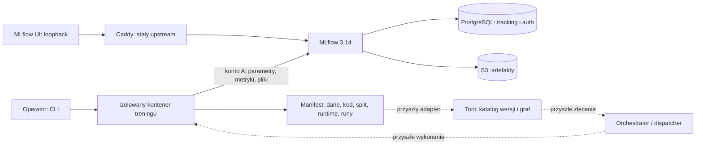

# Torii — architektura narzędzi do tworzenia modeli

2026-10-10. Priorytet użytkownika: budowa warsztatu modeli z nowoczesnym stosem
i grafem zależności. Docker jest dostępny. Ta karta konkretyzuje
[architekturę obiektową](enterprise-object-platform.md) i [sprinty](sprint-plan.md).
Stan wykonania pierwszego adaptera: [SPEC-0020](../../specs/0020-model-workbench-trial/README.md).

## Podział odpowiedzialności

| Warstwa | Narzędzia / kontrakt | Stan |
|---|---|---|
| Katalog i prawa | Torii FastAPI, PostgreSQL, OIDC; Project, Object, Version, Release | Fundament częściowy; katalog/graph nadal do implementacji |
| Dane do modeli | DatasetVersion, snapshot Parquet, digest, schema, quality report | SP-03; obecna próba ma zachowane pliki/digesty, bez gwarancji niezmienności |
| Kod i transformacje | Git + OCI image, kontrakt I/O, wersja transformacji | Lokalny zbudowany obraz z zapisanym image ID; zależności przypięte; import Git później |
| Wykonania | Oddzielne kontenery, limity, Run/Attempt, idempotentna publikacja | Kontener treningowy w próbie; scheduler i recovery należą do SP-04/EXP-01 |
| Eksperymenty | MLflow, parametry, metryki, porównania, artefakty | Lokalny EXP-03a zweryfikowany; bezpośrednia integracja enterprise NO-GO z braku audytu |
| Magazyn artefaktów | S3; lokalnie SeaweedFS, wymienialny adapter | Nowa instalacja próby; nie jest wyborem technologii dla banku |
| Praca badacza | Python/CLI, później Jupyter i SDK z identycznymi uprawnieniami | CLI do uruchamiania workera; Jupyter SP-09 |
| Zależności i pochodzenie | Torii typed relations/outbox, następnie OpenLineage; widok React Flow | Manifesty z referencjami w próbie; graf produktu SP-02/04/06 |
| Promocja modeli | Rejestr, ewaluacja, Release bundle, zatwierdzenie digestu | SP-10B/11/12; alias MLflow nie jest zgodą na wdrożenie |

## Działający przyrost i miejsce integracji

Ciągła linia opisuje zakres próby. Linie przerywane to kontrakty przyszłej
integracji. Worker nie ma kluczy S3/DB, montowania repozytorium ani Docker socket.
Do sprawdzania uprawnień istnieje osobny harness z kontami A/B/admin. Konto admin
nie jest przekazywane badaczowi ani modelowi. Worker/MLflow/DB/S3 nie mają
routowalnej sieci zewnętrznej. Jedynie Caddy łączy sieć API z ingress potrzebnym
do publikacji portu loopback; nie dostaje sekretów ani danych.

## Co otrzymuje autor modelu

Pierwszy worker generuje syntetyczny miesięczny rachunek finansowy i porównuje
baseline z regresją Ridge prognozującą wynik kolejnego miesiąca. Jest to przykład
wykorzystania narzędzi. Nie stanowi zatwierdzonego modelu zysku lub silnika NII.

Każde wykonanie wiąże:

1. konkretne bajty wejść i SHA-256,
2. kod przygotowania cech i chronologiczny split,
3. przypięty obraz i wersje bibliotek,
4. parametry, metryki oraz predykcje,
5. zapisany model i manifest relacji między runami.

Kontener pobiera zapisane artefakty przez API i sprawdza digesty. Powtórka w tym
samym obrazie sprawdza predykcje i metryki; restart usług sprawdza trwałość zapisu.
To są podstawy grafu pochodzenia. Manifest sam w sobie nie zapewnia kontroli
publikacji, WORM, pełnego audytu lub śledzenia każdego odczytu w dowolnym kodzie.
Obraz lokalny uruchamiany jest przez tag `:local`, a jego SHA-256 trafia do
manifestu. Nie ma jeszcze eksportu obrazu do trwałego registry; dostępność
runtime za kilka miesięcy wymaga osobnej retencji i publikacji OCI.

## Kolejność dalszych przyrostów

| Przyrost | Narzędzie / rezultat | Warunek odbioru |
|---|---|---|
| Teraz: EXP-03a / SPEC-0020 | Warsztat MLflow + trwałe metadane/S3 + worker | Trening/replay/restart oraz jawna macierz dostępu; wynik badania nie zalicza całego EXP-03 |
| SP-01 → SP-02 | Tożsamość Torii, katalog obiektów, wersje, deklarowany graf | Uprawnienia w realnym API; z wersji definicji Dataset/Transformation dojście do znanych wersji wejść; modele w SP-10 |
| SP-03 + EXP-02 | Snapshoty danych i publikacja artefaktów | Stare wejście odtwarza się mimo zmiany źródła; awaria nie publikuje częściowego wyniku |
| EXP-01 → SP-04 → SP-06 | Runner/orchestrator i Flow | Restart/retry/cancel bez podwójnej publikacji; powiązania rzeczywistych wykonań |
| SP-10A | Adapter eksperymentów pod tożsamością projektu Torii | Tracking i artefakty przestrzegają ACL/audytu; MLflow nie omija katalogu |
| SP-05 / 08 / 09 | SQL GL/portfele, Git, Jupyter/SDK | Point-in-time dane, przypięty kod, notebook bez sekretów administracyjnych |
| SP-10B / 11 / 12 | Rejestr modeli, ewaluacje, zatwierdzanie | Oddzielna wersja modelu, wynik eksperymentu i zatwierdzone wydanie |

Zachowujemy identyfikatory sprintów z planu. Dwutygodniowy rytm oznacza odbiór
przyrostu i korektę zakresu; nie gwarantuje zamknięcia każdej warstwy w dwa tygodnie.
Dagster pozostaje kandydatem wymagającym EXP-01. MLflow i S3 nie przejmują
zarządzania domeną Torii. Nie dodajemy Kubernetes do lokalnego przyrostu, zanim
kontrakt workera i publikacji wyników zostanie sprawdzony.

Instrukcja uruchomienia: [warsztat lokalny](../../deploy/experiments/mlflow-access/OPERATIONS.md).
Podstawa wyboru narzędzi i ograniczenia: [ADR-0007](../../adr/0007-model-workbench-trial.md).
